# IMOS · Ichiban Paint Motobuilt — Game Center

Satu website berisi **empat game** event Ichiban:

| No | Game | Layar TV | Admin game | Papan skor |
|----|------|----------|------------|------------|
| 1 | Spin Wheel | `/spin-wheel/tv` | `/spin-wheel/admin` | – |
| 2 | Ichiban Run | `/ichiban-run/tv` | `/ichiban-run/admin` | `/ichiban-run/leaderboard` |
| 3 | Spray Paint Challenge | `/spray-paint/tv` | `/spray-paint/admin` | `/spray-paint/leaderboard` |
| 4 | Drag Race Reaction | `/drag-race/tv` | `/drag-race/admin` | `/drag-race/leaderboard` |

- **Satu kali `npm start`** menjalankan keempat game sekaligus.
- **Halaman depan** (`/`) adalah menu bergaya IMOS untuk memilih game.
- **Setiap game punya admin sendiri** dengan pengaturan, password, data peserta, papan skor dan ekspor CSV masing-masing. Mengubah pengaturan Drag Race tidak mengubah game lain.
- **Keempat game bisa jalan bersamaan** di TV yang berbeda (TV 1 Spin Wheel, TV 2 Drag Race, dan seterusnya). Satu game juga boleh dibuka di beberapa TV.
- **Super-admin** (`/admin`) menampilkan status semua game: layar TV yang aktif, jumlah peserta/permainan, tombol ke admin tiap game, dan QR alamat layar TV.
- Semua fitur, suara, musik dan gambar dari keempat aplikasi asli tetap ada. Semua berjalan **tanpa internet** lewat Wi-Fi lokal.

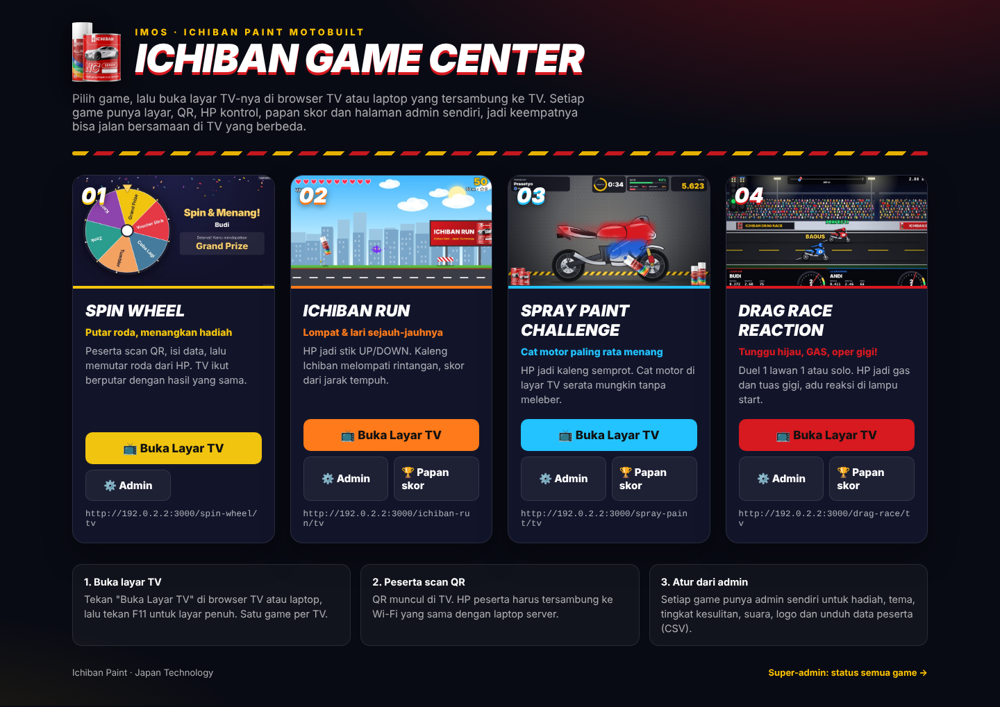

---

## 1. Cara menjalankan

1. Install **Node.js versi 18 atau lebih baru** dari https://nodejs.org (pilih versi LTS).
2. Ekstrak zip ini.
3. **Windows:** klik dua kali `MULAI-GAME.bat`. (Pertama kali, file ini otomatis menjalankan `npm install`.)
   **Mac / Linux / manual:** buka Terminal di folder `imos-games`, lalu jalankan:
   ```
   npm install
   npm start
   ```
4. Terminal menampilkan semua alamat, misalnya:
   ```
   === IMOS · Ichiban Paint Motobuilt — Game Center ===
   Menu semua game : http://192.168.1.10:3000/
   Super-admin     : http://192.168.1.10:3000/admin

     Drag Race Reaction
       Layar TV  : http://192.168.1.10:3000/drag-race/tv
       Admin     : http://192.168.1.10:3000/drag-race/admin
       Papan skor: http://192.168.1.10:3000/drag-race/leaderboard
     ...
   ```
5. Biarkan jendela Terminal tetap terbuka selama event. Menutupnya = semua game berhenti.

> HP peserta harus tersambung ke **Wi-Fi yang sama** dengan laptop server, karena QR berisi alamat laptop di jaringan lokal.

---

## 2. Memasang di beberapa TV

Contoh susunan booth dengan 4 TV:

| TV | Buka alamat ini di browser TV / laptop yang tersambung ke TV |
|----|------|
| TV 1 | `http://IP-LAPTOP:3000/spin-wheel/tv` |
| TV 2 | `http://IP-LAPTOP:3000/ichiban-run/tv` |
| TV 3 | `http://IP-LAPTOP:3000/spray-paint/tv` |
| TV 4 | `http://IP-LAPTOP:3000/drag-race/tv` |

Cara paling mudah: buka menu `http://IP-LAPTOP:3000/` di tiap TV, lalu tekan **Buka Layar TV** pada game yang diinginkan. Tekan **F11** untuk layar penuh. Di Smart TV atau tablet yang susah mengetik, buka **Super-admin** di laptop lalu scan QR di kartu game dengan kamera perangkat tersebut.

Server bisa jalan di salah satu laptop TV, atau di laptop terpisah. Semua TV dan HP cukup tersambung ke Wi-Fi yang sama.

**Suara:** browser memblokir suara sebelum ada klik. Setelah layar TV terbuka, klik sekali di layar (atau tombol "Klik untuk aktifkan suara") supaya musik dan efek suara terdengar.

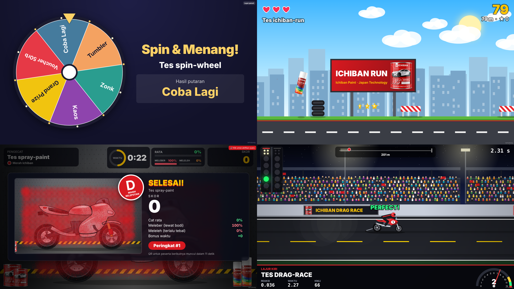

---

## 3. Admin tiap game

Setiap game diatur dari halaman admin-nya sendiri, misalnya `http://IP-LAPTOP:3000/drag-race/admin`. Isinya sama dengan aplikasi aslinya:

- **Spin Wheel:** daftar hadiah, warna, bobot peluang, stok, atur hasil per nomor HP atau "putaran berikutnya", data peserta, ekspor CSV.
- **Ichiban Run:** branding, nyawa, kecepatan, tinggi lompatan, rintangan, koin, karakter kaleng, logo, papan skor, uji coba, ekspor CSV.
- **Spray Paint Challenge:** template motor/helm, waktu, ukuran & tenaga semprot, lelehan cat, penilaian, suara dan musik, upload template/logo/musik, ekspor CSV.
- **Drag Race Reaction:** mode duel/solo, lampu start, aturan false start, tenaga motor, gigi, zona PERFECT, poin, branding, volume, upload musik, ekspor CSV.

Panduan lengkap tiap game ada di folder [`docs/`](docs/) (ditulis untuk versi terpisah; alamatnya sekarang diawali nama game, mis. `/drag-race/tv`).

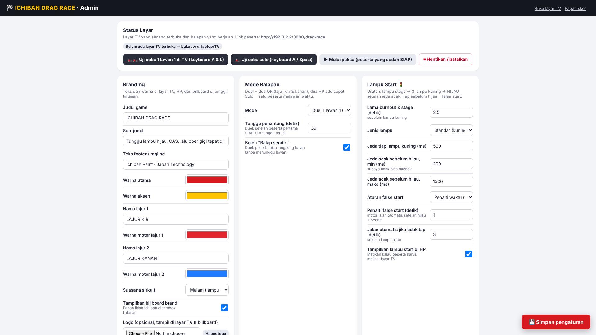

---

## 4. Password admin

Semua password ada di file **`config.json`** (buka dengan Notepad):

```json
{
  "port": 3000,
  "publicUrl": "",
  "superAdminPassword": "admin123",
  "apps": {
    "spin-wheel":  { "enabled": true, "adminPassword": "admin123" },
    "ichiban-run": { "enabled": true, "adminPassword": "admin123" },
    "spray-paint": { "enabled": true, "adminPassword": "admin123" },
    "drag-race":   { "enabled": true, "adminPassword": "admin123" }
  }
}
```

- `adminPassword` di tiap game = password halaman admin game itu. Boleh dibuat berbeda, misalnya supaya crew Drag Race hanya bisa mengatur Drag Race.
- `superAdminPassword` = password halaman `/admin` (status semua game).
- **Ganti `admin123` sebelum event**, lalu jalankan ulang server.
- `"enabled": false` menyembunyikan dan mematikan satu game.
- `port` = nomor port (bawaan 3000).
- `publicUrl` = isi hanya kalau website dipasang online, mis. `"https://game.imos-ichiban.com"`. Kosongkan untuk pemakaian Wi-Fi lokal.

Bisa juga lewat environment variable (lebih diutamakan daripada `config.json`): `PORT`, `PUBLIC_URL`, `ADMIN_PASSWORD` (semua game), `SUPER_ADMIN_PASSWORD`, `SPIN_WHEEL_ADMIN_PASSWORD`, `ICHIBAN_RUN_ADMIN_PASSWORD`, `SPRAY_PAINT_ADMIN_PASSWORD`, `DRAG_RACE_ADMIN_PASSWORD`, `DATA_DIR`.

---

## 5. Data & backup

Data tiap game tersimpan terpisah di folder `data/`:

```
data/
  spin-wheel/data.json          peserta, hadiah, pengaturan
  ichiban-run/data.json         skor & pengaturan, uploads/ (logo, karakter)
  spray-paint/data.json         skor & pengaturan, uploads/ (template, logo, musik, foto hasil)
  drag-race/data.json           skor & pengaturan, uploads/ (logo, musik)
```

- **Backup:** salin folder `data/` saat server mati.
- **Mulai dari nol:** matikan server, hapus folder satu game di `data/` (atau seluruh `data/`).
- Data dari aplikasi versi terpisah bisa dipindahkan: salin `data.json` (dan folder `uploads/`) dari folder game lama ke `data/<nama-game>/`. Logo atau musik yang di-upload di versi lama sebaiknya di-upload ulang dari admin.

---

## 6. Struktur folder

```
imos-games/
  server.js          server utama (menu, super-admin, memasang keempat game)
  config.json        port & password
  MULAI-GAME.bat     tombol start untuk Windows
  public/            halaman menu & super-admin
  apps/
    spin-wheel/      server.js + public/ (TV, HP, admin)
    ichiban-run/
    spray-paint/
    drag-race/
  docs/              panduan lengkap tiap game
  screenshots/
```

---

## 7. Tips & masalah umum

- **QR tidak bisa dibuka di HP:** pastikan HP di Wi-Fi yang sama, dan Windows Firewall mengizinkan Node.js (pilih "Allow" saat pertama kali muncul, centang Private network).
- **Alamat di QR salah (laptop punya beberapa jaringan):** isi `publicUrl` di `config.json` dengan alamat yang benar, mis. `"http://192.168.1.10:3000"`.
- **Port 3000 sudah dipakai:** ganti `port` di `config.json`.
- **Gerakan miring (tilt) di Spray Paint** butuh HTTPS. Di Wi-Fi lokal (HTTP) otomatis kembali ke mode sentuh.
- Jaringan Wi-Fi yang stabil penting untuk Drag Race (waktu reaksi). Gunakan router sendiri di booth bila memungkinkan, jangan Wi-Fi umum yang ramai.

---

## Screenshot

| | |
|---|---|
| 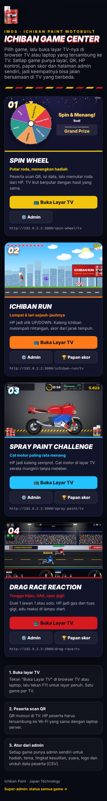 Menu di HP | 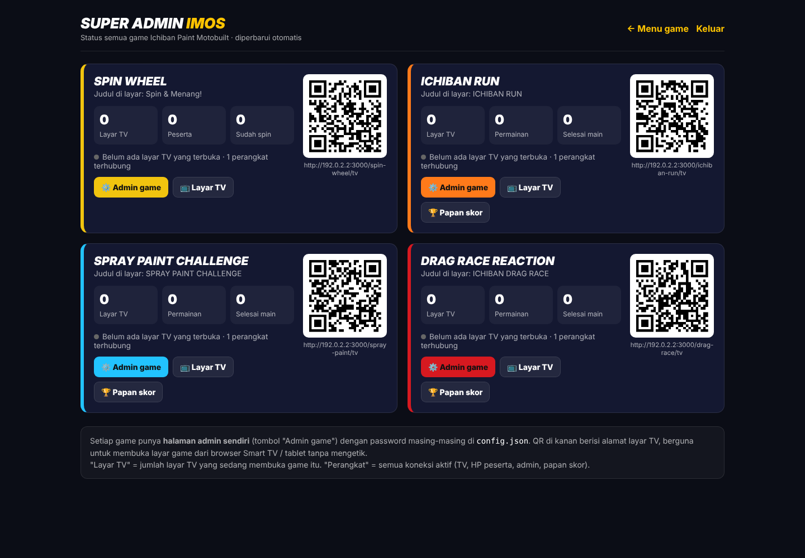 Super-admin |
| 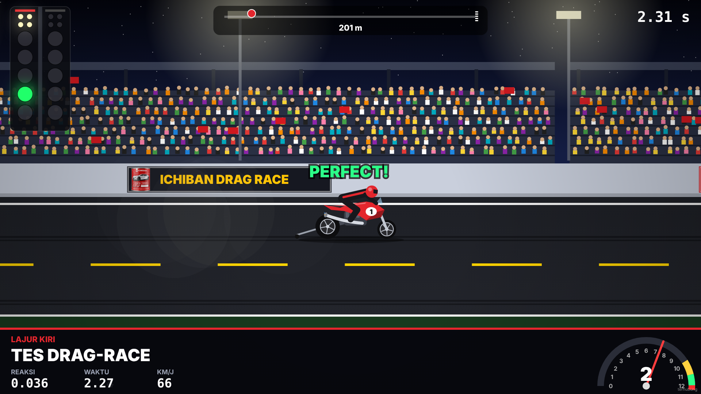 TV Drag Race | 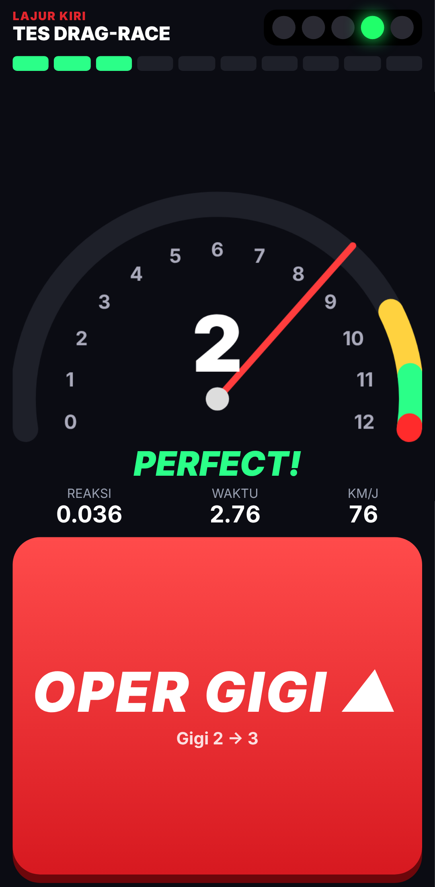 HP Drag Race |
| 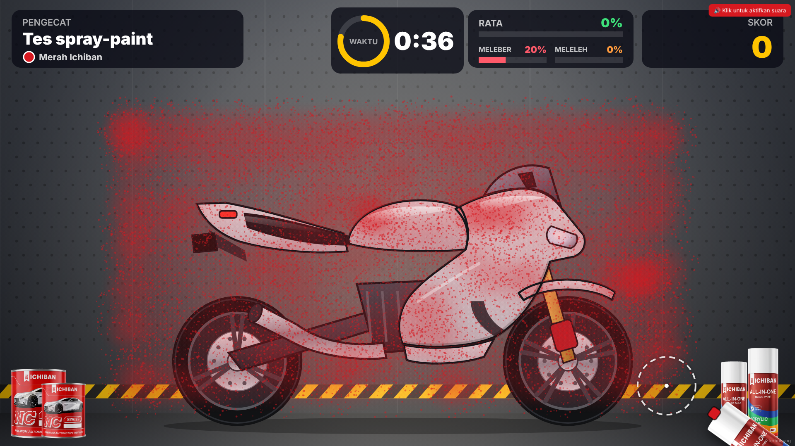 TV Spray Paint | 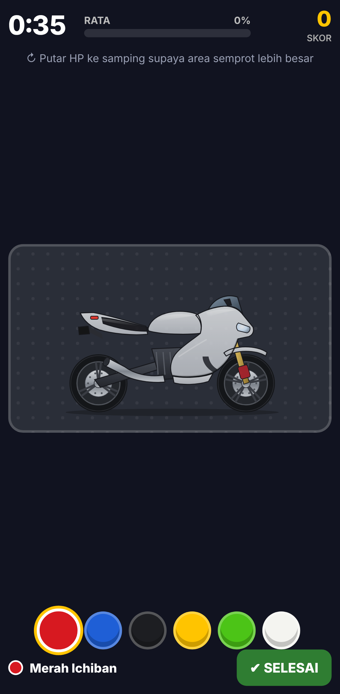 HP Spray Paint |
| 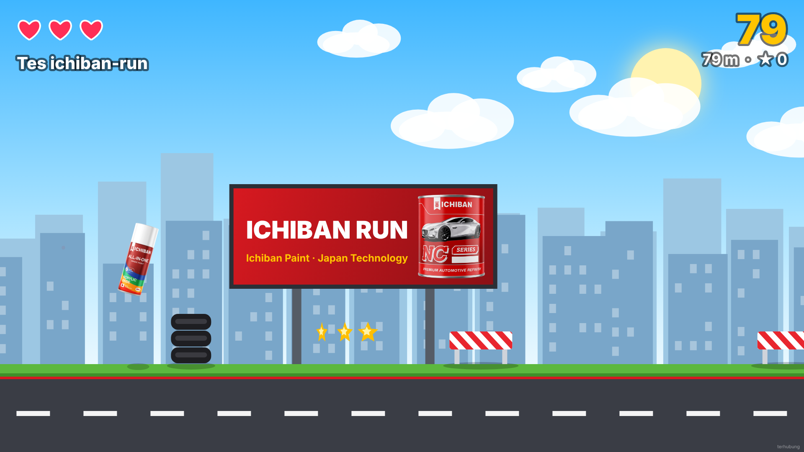 TV Ichiban Run | 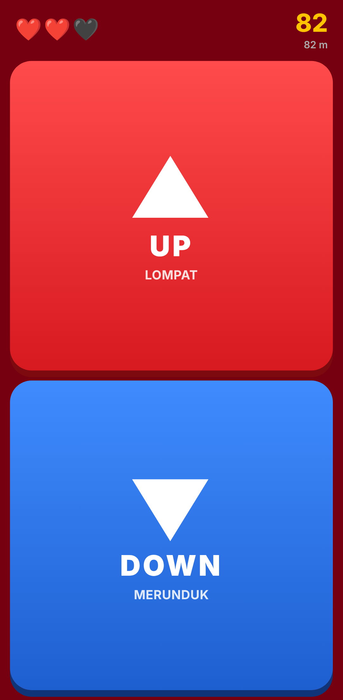 HP Ichiban Run |
| 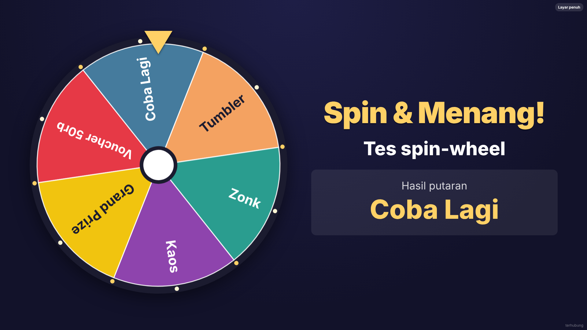 TV Spin Wheel | 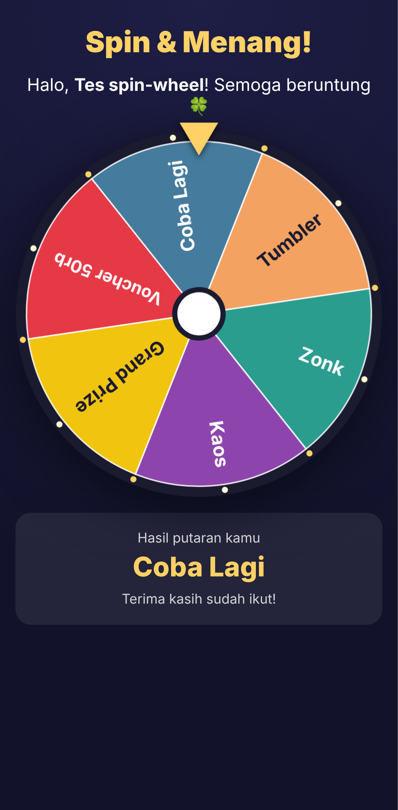 HP Spin Wheel |
